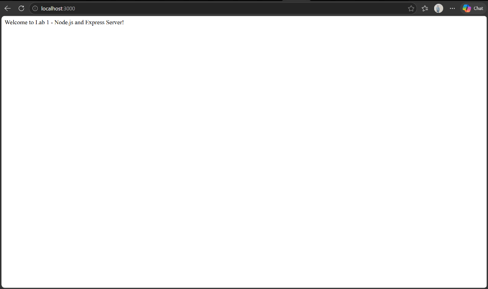
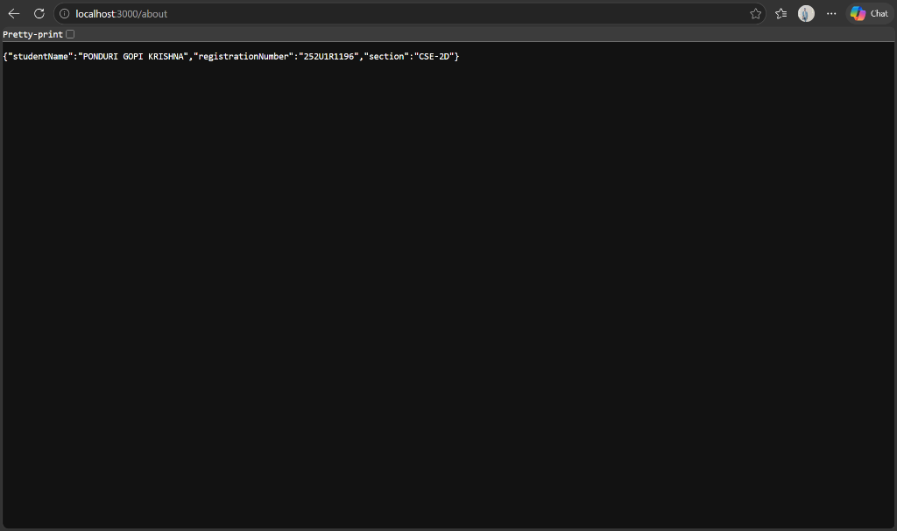
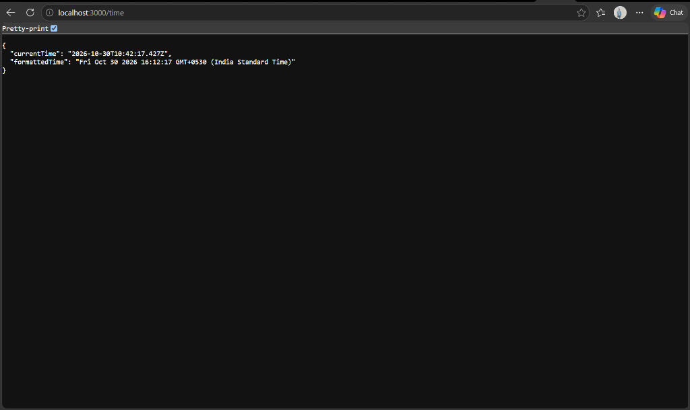
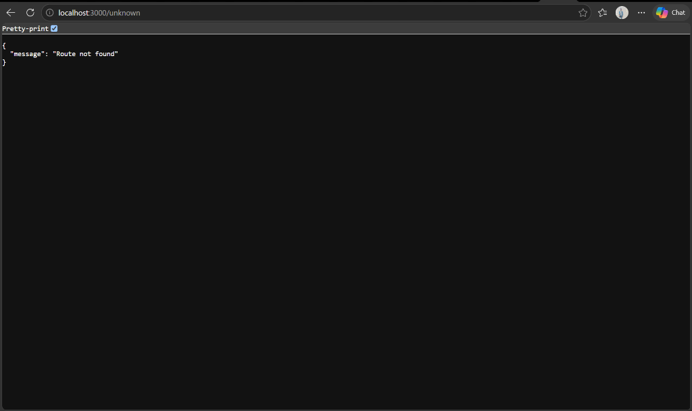

# Lab 1 – Node.js and Express Server

## Live Deployment (Render)

The application is deployed live on Render:

- **Base URL (Home):** [https://gopi-krishna.onrender.com/](https://gopi-krishna.onrender.com/)
- **About Route:** [https://gopi-krishna.onrender.com/about](https://gopi-krishna.onrender.com/about)
- **Current Date & Time:** [https://gopi-krishna.onrender.com/time](https://gopi-krishna.onrender.com/time)
- **404 Error Found:** [https://gopi-krishna.onrender.com/unknown](https://gopi-krishna.onrender.com/unknown)

---

## Student Information

- **Student Name:** PONDURI GOPI KRISHNA
- **Registration Number:** `252U1R1196`
- **Section:** `CSE-2D`
- **Course:** Backend Development Fundamentals
- **Lab Number:** Lab 01

---

## 1. Project Objective

The primary objectives of this lab are:
1. To understand the fundamental concepts of asynchronous backend web servers in Node.js.
2. To build a low-level HTTP server using the Node.js standard built-in `http` module.
3. To develop a robust, structured RESTful API server using the **Express.js** web framework.
4. To implement route handlers for standard GET requests, return JSON data, and capture server-side timestamps.
5. To implement custom middleware for handling `404 Not Found` routes with standardized JSON error responses.
6. To configure environment-aware port bindings (`process.env.PORT`) to ensure seamless execution both locally and on cloud hosting platforms such as **Render**.
7. To establish industry-standard Git version control practices and document setup procedures.

---

## 2. Technologies Used

- **Runtime Environment:** [Node.js](https://nodejs.org/) (v24.x LTS / CommonJS module system)
- **Framework:** [Express.js](https://expressjs.com/) (v5.x / minimalist web framework)
- **Built-in Module:** `http` (Node.js core module for low-level server creation)
- **Development Tool:** [Nodemon](https://nodemon.io/) (automatic server reloading during development)
- **Version Control:** Git & GitHub
- **Deployment Platform Target:** Render

---

## 3. Explanation of package.json Fields

The `package.json` file serves as the manifest and dependency manager of a Node.js project. Key fields configured in this project include:

| Field | Purpose / Description |
| :--- | :--- |
| `name` | The lowercase, URL-friendly unique identifier of the package (`lab-01`). |
| `version` | Follows Semantic Versioning (`1.0.0` - Major.Minor.Patch). |
| `description` | A concise summary of the module's purpose. |
| `main` | The entry point of the package when imported or executed (`server.js`). |
| `scripts` | CLI shortcuts for running project tasks: <br>• `start`: Executes the production server (`node server.js`). <br>• `dev`: Runs the development server with live reload (`nodemon server.js`). <br>• `start:http`: Runs the native HTTP server (`node http-server.js`). |
| `keywords` | Array of searchable terms relevant to the package. |
| `author` | Credits the developer (`PONDURI GOPI KRISHNA`). |
| `license` | Legal licensing terms (`ISC`). |
| `dependencies` | Production packages required at runtime (e.g., `express`). |
| `devDependencies` | Packages required only during local development (e.g., `nodemon`). |

---

## 4. Explanation of Both Servers

### A. Plain Node.js HTTP Server (`http-server.js`)
- **How it works:** Utilizes Node's internal `http.createServer()` callback function.
- **Request Cycle:** Each incoming HTTP request triggers the callback function `(req, res)`.
- **Headers & Response:** HTTP status code 200 and `Content-Type: text/plain` are manually sent via `res.writeHead()`, and `"Hello"` is sent via `res.end()`.
- **Characteristics:** Requires manual URL parsing, query string handling, and routing if expanded. Demonstrates foundational principles behind all Node.js web frameworks.

### B. Express.js Server (`server.js`)
- **How it works:** Initializes an Express application instance (`const app = express()`). Express abstracts low-level stream handling, header writing, and routing into a clear, declarative routing pipeline.
- **Routing Engine:** Direct mapping of HTTP verbs (`app.get()`) to specific URI paths (`/`, `/about`, `/time`).
- **Response Methods:** Uses `res.status(200).send()` for plain text responses and `res.status(200).json()` for automatic JSON serialization and `Content-Type: application/json` headers.
- **Middleware Pipeline:** Middleware functions execute sequentially. A catch-all middleware placed at the very end handles unknown routes and sends a standard 404 JSON response.

---

## 5. API Endpoint Specifications

The Express server exposes the following endpoints:

| HTTP Method | Route Path | Description | Expected Status Code | Response Format | Example Response |
| :--- | :--- | :--- | :---: | :--- | :--- |
| `GET` | `/` | Root endpoint displaying a welcome message | `200 OK` | `text/html; charset=utf-8` | `"Welcome to Lab 1 - Node.js and Express Server!"` |
| `GET` | `/about` | Returns student details | `200 OK` | `application/json` | `{"studentName": "PONDURI GOPI KRISHNA", "registrationNumber": "252U1R1196", "section": "CSE-2D"}` |
| `GET` | `/time` | Returns the current server timestamp | `200 OK` | `application/json` | `{"currentTime": "2026-10-30T10:15:00.000Z", "formattedTime": "Fri Oct 30 2026 ..."}` |
| `GET` / `ALL` | `/*` (e.g., `/unknown`) | Catch-all 404 error handler for undefined routes | `404 Not Found` | `application/json` | `{"message": "Route not found"}` |

---

## 6. Installation & Execution Guide

### Prerequisites
- Node.js (v18.x or higher) installed: Verify using `node -v`
- npm (v9.x or higher) installed: Verify using `npm -v`

### Step 1: Navigate to the Lab 1 Directory
```bash
cd "Gopi-Krishna/lab-01"
```

### Step 2: Install Project Dependencies
```bash
npm install
```

### Step 3: Run the Servers

#### Running the Native Node.js HTTP Server:
```bash
node http-server.js
# Or via npm script:
npm run start:http
```
*Accessible at: `http://localhost:3000`*

#### Running the Production Express Server:
```bash
npm start
```
*Accessible at: `http://localhost:3000`*

#### Running the Development Express Server (Auto-reload on code change):
```bash
npm run dev
```

---

## 7. Screenshots of Endpoint Verification

The screenshots below provide verification of the four primary endpoints tested locally and on the live deployed Render instance.

> *Instructions to capture and update images are documented in [`screenshots/README.md`](./screenshots/README.md).*

### 1. Home Endpoint (`GET /`)
- **Render Live URL:** [https://gopi-krishna.onrender.com/](https://gopi-krishna.onrender.com/)  
- **Expected HTTP Status:** `200 OK`  



---

### 2. About Endpoint (`GET /about`)
- **Render Live URL:** [https://gopi-krishna.onrender.com/about](https://gopi-krishna.onrender.com/about)  
- **Expected HTTP Status:** `200 OK`  



---

### 3. Time Endpoint (`GET /time`)
- **Render Live URL:** [https://gopi-krishna.onrender.com/time](https://gopi-krishna.onrender.com/time)  
- **Expected HTTP Status:** `200 OK`  



---

### 4. Unknown Endpoint (`GET /unknown` - 404 Handling)
- **Render Live URL:** [https://gopi-krishna.onrender.com/unknown](https://gopi-krishna.onrender.com/unknown)  
- **Expected HTTP Status:** `404 Not Found`  



---

## 8. Problems Faced and Solutions

1. **Port Conflicts during Local Testing:**
   - *Problem:* Attempting to run both `http-server.js` and `server.js` concurrently caused an `EADDRINUSE: address already in use :::3000` error.
   - *Solution:* Implemented dynamic port assignment using `process.env.PORT || 3000`. When testing simultaneously, one server can be run with an overridden port (e.g., `PORT=4000 node http-server.js` or testing sequentially).

2. **Hardcoded Port Prevention for Cloud Deployment:**
   - *Problem:* Cloud platforms such as Render allocate arbitrary ports dynamically via the `PORT` environment variable. Hardcoding port 3000 would cause deployment health checks to fail.
   - *Solution:* Used `const PORT = process.env.PORT || 3000;` allowing Render to bind its preferred port while defaulting to 3000 during local development.

3. **Ordering of 404 Middleware:**
   - *Problem:* Placing the 404 middleware before the route definitions intercepted all incoming requests, preventing valid routes (`/`, `/about`, `/time`) from being reached.
   - *Solution:* Positioned the 404 middleware `app.use(...)` after all route declarations so that it acts as a fallthrough catcher only for unhandled requests.

4. **Accidental Upload of `node_modules`:**
   - *Problem:* The `node_modules` folder contains thousands of heavy files that should never be pushed to version control.
   - *Solution:* Configured `.gitignore` to strictly exclude `node_modules/` and environment files `.env`.

---

## 9. Conclusion

In this lab, we successfully built and contrasted two backend architectures:
- A minimalist native HTTP server using Node.js's built-in `http` module.
- A production-ready REST API server using Express.js featuring custom routes, JSON handling, and 404 middleware.

The project demonstrates clean separation of concerns, best practices for dependency management, environment variable adaptability for cloud deployment, and comprehensive API documentation.
