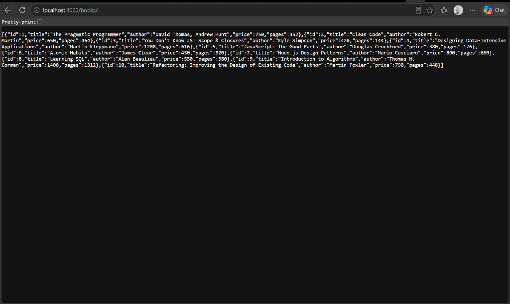
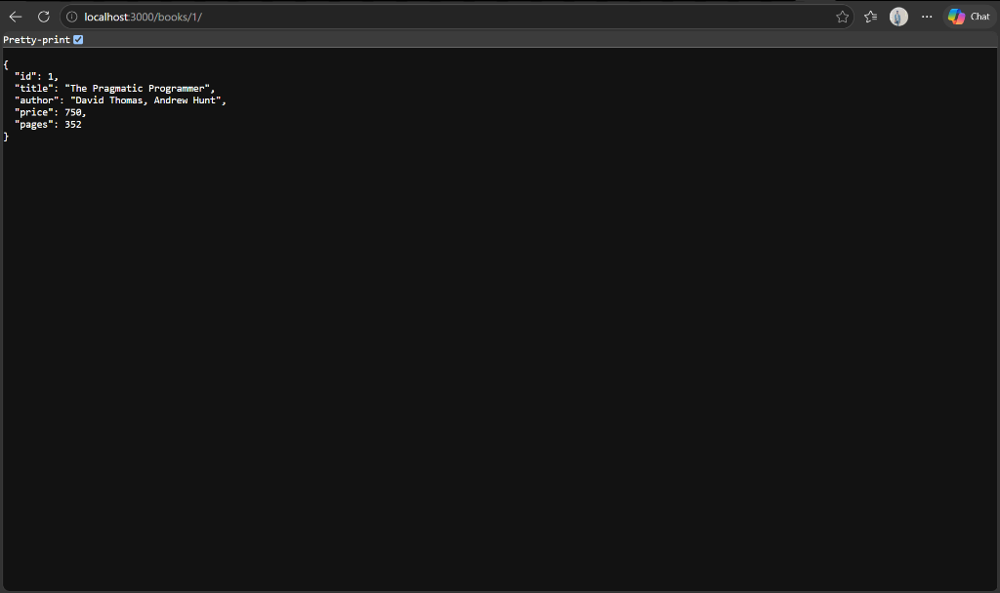
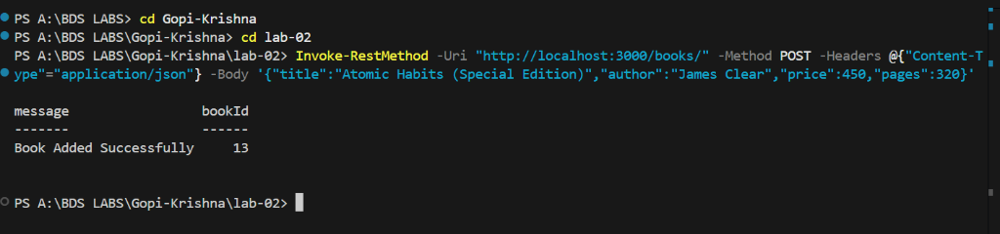
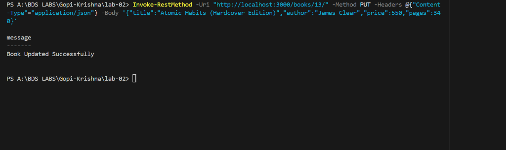
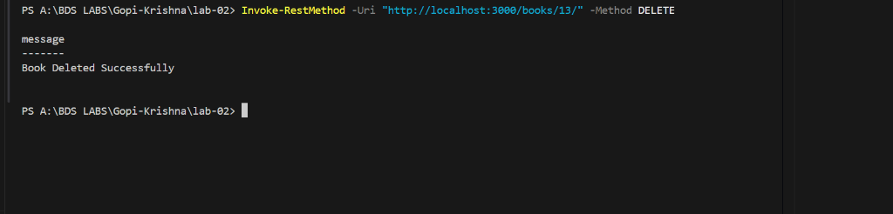
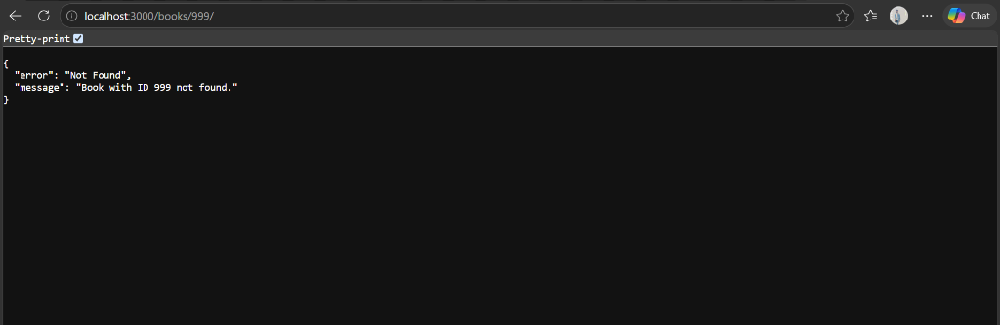
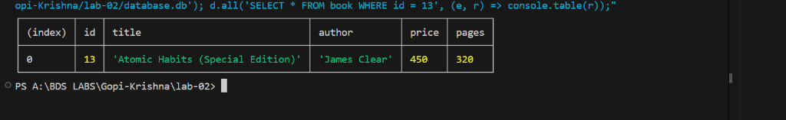
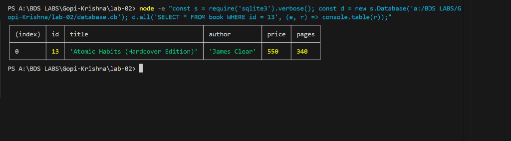
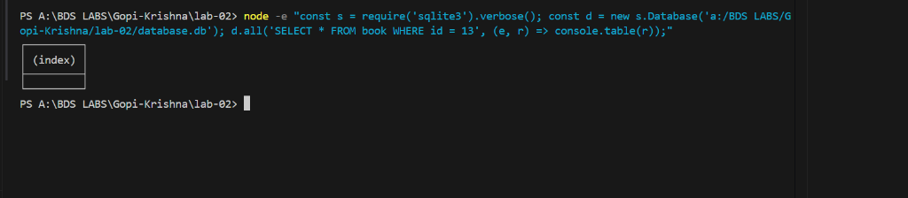

# Lab 2 – SQLite Database and CRUD Routes

> **Deployment Status:** Architecture Prepared (Local & Persistent Cloud Ready)  
> **Evaluation of SQLite File Persistence:**  
> Free cloud container hosts (such as Render Free Web Services) use an **ephemeral filesystem**. While the application starts and runs normally, any database modifications (POST, PUT, DELETE written to `database.db`) are discarded when the container sleeps or redeploys. For persistent SQLite hosting, a platform supporting **Persistent Disks / Volumes** (such as Render Disks on paid plans, Fly.io volumes, Railway with volume mounts) or stateful development environments (such as **NxtWave Cloud IDE** or dedicated VPS) is recommended.

---

## Student Information

- **Student Name:** PONDURI GOPI KRISHNA
- **Registration Number:** `252U1R1196`
- **Section:** `CSE-2D`
- **Course:** Backend Development Fundamentals
- **Lab Number:** Lab 02
- **Repository Name:** `Gopi-Krishna`

---

## 1. Project Objective

The objectives of Lab 2 are:
1. To integrate a persistent relational SQL database (**SQLite**) with a Node.js and **Express.js** application.
2. To structure a clean database schema and seed it with realistic initial records.
3. To implement an asynchronous startup lifecycle using `initializeDBAndServer()`, ensuring the server only accepts incoming requests after database initialization succeeds.
4. To design and implement standard RESTful **CRUD** (Create, Read, Update, Delete) routes:
   - `GET /books/`
   - `GET /books/:bookId/`
   - `POST /books/`
   - `PUT /books/:bookId/`
   - `DELETE /books/:bookId/`
5. To strictly implement **parameterized SQL queries** (`?` placeholders) across all user inputs to eliminate SQL Injection (SQLi) vulnerabilities.
6. To validate client request bodies and URL parameters, returning appropriate HTTP status codes (`200 OK`, `201 Created`, `400 Bad Request`, `404 Not Found`, `500 Internal Server Error`).
7. To verify database consistency using SQLite queries and API testing tools (Postman / Curl).

---

## 2. Technologies Used

- **Runtime Environment:** [Node.js](https://nodejs.org/) (v24.x LTS / CommonJS)
- **Framework:** [Express.js](https://expressjs.com/) (v5.x REST framework)
- **Database Engine:** [SQLite3](https://www.sqlite.org/) (Serverless, zero-configuration SQL database engine)
- **Database Driver Wrapper:** [`sqlite`](https://www.npmjs.com/package/sqlite) (Promise-based asynchronous client for sqlite3)
- **Development Tool:** [Nodemon](https://nodemon.io/) (Live server reloading)
- **API Testing:** Postman & Node.js HTTP test suites
- **Version Control:** Git & GitHub

---

## 3. SQLite Database Structure

The project uses a single file database: `database.db`.

### Table Schema: `book`

```sql
CREATE TABLE IF NOT EXISTS book (
  id INTEGER PRIMARY KEY AUTOINCREMENT,
  title TEXT NOT NULL,
  author TEXT NOT NULL,
  price INTEGER NOT NULL,
  pages INTEGER NOT NULL
);
```

### Column Specifications:

| Column | Data Type | Constraints | Description |
| :--- | :--- | :--- | :--- |
| `id` | `INTEGER` | `PRIMARY KEY AUTOINCREMENT` | Unique identifier generated automatically for each book |
| `title` | `TEXT` | `NOT NULL` | The title/name of the book |
| `author` | `TEXT` | `NOT NULL` | The author(s) of the book |
| `price` | `INTEGER` | `NOT NULL` | Price in integer currency units (e.g. INR / USD cents) |
| `pages` | `INTEGER` | `NOT NULL` | Total page count |

### Seeded Records (10 Sample Books):
1. *The Pragmatic Programmer* – David Thomas, Andrew Hunt (Price: 750, Pages: 352)
2. *Clean Code* – Robert C. Martin (Price: 650, Pages: 464)
3. *You Don't Know JS: Scope & Closures* – Kyle Simpson (Price: 420, Pages: 144)
4. *Designing Data-Intensive Applications* – Martin Kleppmann (Price: 1200, Pages: 616)
5. *JavaScript: The Good Parts* – Douglas Crockford (Price: 380, Pages: 176)
6. *Atomic Habits* – James Clear (Price: 450, Pages: 320)
7. *Node.js Design Patterns* – Mario Casciaro (Price: 890, Pages: 660)
8. *Learning SQL* – Alan Beaulieu (Price: 550, Pages: 380)
9. *Introduction to Algorithms* – Thomas H. Cormen (Price: 1400, Pages: 1312)
10. *Refactoring: Improving the Design of Existing Code* – Martin Fowler (Price: 790, Pages: 448)

---

## 4. Explanation of CRUD Operations

CRUD represents the four primitive functions of persistent storage in computing:

| CRUD Operation | HTTP Verb | SQL Statement | Purpose in Lab 2 |
| :--- | :---: | :--- | :--- |
| **Create** | `POST` | `INSERT INTO book ...` | Adds a new book record with generated ID |
| **Read (All)** | `GET` | `SELECT * FROM book ...` | Fetches an array of all book objects |
| **Read (One)** | `GET` | `SELECT * FROM book WHERE id = ?` | Fetches a single book matching the requested `bookId` |
| **Update** | `PUT` | `UPDATE book SET ... WHERE id = ?` | Modifies title, author, price, and pages of an existing book |
| **Delete** | `DELETE` | `DELETE FROM book WHERE id = ?` | Removes a book record from the database by `bookId` |

---

## 5. Database Initialization Explanation (`initializeDBAndServer`)

In asynchronous Node.js applications, attempting to query a database before the connection handshake completes causes runtime errors (`UnhandledPromiseRejection` or `TypeError: Cannot read properties of null`).

```javascript
const initializeDBAndServer = async () => {
  try {
    // Step 1: Open the SQLite database connection using promise wrapper
    db = await open({
      filename: path.join(__dirname, 'database.db'),
      driver: sqlite3.Database
    });

    // Step 2: Ensure table exists and seed initial data if empty
    await db.exec(`CREATE TABLE IF NOT EXISTS book (...);`);
    
    // Step 3: Start the Express server ONLY after database is ready
    app.listen(PORT, () => {
      console.log(`Server running at http://localhost:${PORT}/`);
    });
  } catch (error) {
    console.error(`DB Error: ${error.message}`);
    process.exit(1); // Terminate process on unrecoverable DB error
  }
};
```

**Why this pattern is important:**
- Guarantees sequential execution: `Database Ready` -> `Routes Ready` -> `Server Listening`.
- Isolates connection failures early during server startup.
- Keeps the connection object `db` in module scope so all route handlers can query it seamlessly.

---

## 6. API Endpoint Specifications Table

| HTTP Method | Endpoint URL | Description | Required Request Body | Expected Status | Example Response Payload |
| :---: | :--- | :--- | :--- | :---: | :--- |
| `GET` | `/books/` | Fetch all books | None | `200 OK` | `[{"id":1,"title":"The Pragmatic Programmer",...}]` |
| `GET` | `/books/:bookId/` | Fetch single book by ID | None | `200 OK` / `404 Not Found` | `{"id":1,"title":"The Pragmatic Programmer",...}` |
| `POST` | `/books/` | Insert a new book | JSON object with `title`, `author`, `price`, `pages` | `201 Created` / `400 Bad Request` | `{"message":"Book Added Successfully","bookId":11}` |
| `PUT` | `/books/:bookId/` | Update existing book | JSON object with `title`, `author`, `price`, `pages` | `200 OK` / `404 Not Found` | `{"message":"Book Updated Successfully"}` |
| `DELETE` | `/books/:bookId/` | Delete book by ID | None | `200 OK` / `404 Not Found` | `{"message":"Book Deleted Successfully"}` |

---

## 7. Sample Request Bodies & Responses

### A. POST /books/ (Create Book)
**Request Body:**
```json
{
  "title": "Atomic Habits",
  "author": "James Clear",
  "price": 450,
  "pages": 320
}
```
**Response (Status: `201 Created`):**
```json
{
  "message": "Book Added Successfully",
  "bookId": 11
}
```

### B. PUT /books/:bookId/ (Update Book)
**Request Body:**
```json
{
  "title": "Atomic Habits (Hardcover Edition)",
  "author": "James Clear",
  "price": 550,
  "pages": 340
}
```
**Response (Status: `200 OK`):**
```json
{
  "message": "Book Updated Successfully"
}
```

### C. 404 Response (Non-Existent Book)
**Response (Status: `404 Not Found`):**
```json
{
  "error": "Not Found",
  "message": "Book with ID 999 not found."
}
```

---

## 8. Parameterized Queries & SQL Injection Prevention

### What is SQL Injection (SQLi)?
SQL Injection is a severe security vulnerability where an attacker manipulates SQL queries by injecting malicious SQL code into input fields (e.g. `bookId = 1 OR 1=1; DROP TABLE book;`).

### Bad Practice (String Concatenation - Vulnerable):
```javascript
// DANGEROUS: Direct concatenation allows arbitrary SQL commands to be executed
const badQuery = `SELECT * FROM book WHERE id = ${bookId};`;
```

### Best Practice (Parameterized Queries - Secure):
```javascript
// SECURE: Uses '?' as a placeholder. The database engine treats the parameter
// strictly as literal data, never as executable SQL code.
const secureQuery = `SELECT * FROM book WHERE id = ?;`;
const book = await db.get(secureQuery, [bookId]);
```

All route handlers in this application strictly enforce parameterized queries with `?` placeholders.

---

## 9. SQLite CLI Verification Commands

To directly inspect and verify the database from the terminal:

### 1. View All Books:
```bash
sqlite3 database.db "SELECT * FROM book;"
```
*(Or via Node runner: `node -e "const s = require('sqlite3').verbose(); const d = new s.Database('./database.db'); d.all('SELECT * FROM book', (e, r) => console.table(r));"`)*

### 2. Verify Record After Insertion:
```bash
sqlite3 database.db "SELECT * FROM book WHERE id = 13;"
```

### 3. Verify Record After Update:
```bash
sqlite3 database.db "SELECT * FROM book WHERE id = 13;"
```

### 4. Verify Record After Deletion:
```bash
sqlite3 database.db "SELECT * FROM book WHERE id = 13;"
# Output will be empty, confirming the record was removed.
```

---

## 10. Installation & Execution Guide

### Step 1: Navigate to the Lab 2 Directory
```bash
cd "Gopi-Krishna/lab-02"
```

### Step 2: Install Dependencies
```bash
npm install
```

### Step 3: Run the Server
```bash
# Production Mode:
npm start

# Development Mode with Live Auto-reload (Nodemon):
npm run dev
```
*Server runs at: `http://localhost:3000/`*  
*Books endpoint: `http://localhost:3000/books/`*

---

## 11. Screenshots of Endpoint & Database Verification

> *Capture guidelines and naming requirements are documented in [`screenshots/README.md`](./screenshots/README.md).*

### 1. GET All Books (`GET /books/`)
Expected HTTP Status: `200 OK`  


### 2. GET One Book (`GET /books/1/`)
Expected HTTP Status: `200 OK`  


### 3. POST New Book (`POST /books/`)
Expected HTTP Status: `201 Created`  


### 4. PUT Update Book (`PUT /books/:bookId/`)
Expected HTTP Status: `200 OK`  


### 5. DELETE Book (`DELETE /books/:bookId/`)
Expected HTTP Status: `200 OK`  


### 6. 404 Error Handling (`GET /books/999/` or Unknown Route)
Expected HTTP Status: `404 Not Found`  


### 7. SQLite Database: Inserted Record Verification


### 8. SQLite Database: Updated Record Verification


### 9. SQLite Database: Deleted Record Verification


---

## 12. Problems Faced and Solutions

1. **Premature Request Handling Before Database Readiness:**
   - *Problem:* Calling `app.listen()` immediately while `open()` was resolving caused route handlers to query `db` when it was still `null`.
   - *Solution:* Encapsulated server startup inside `initializeDBAndServer()` and awaited database connection resolution before invoking `app.listen()`.

2. **SQL Injection Vulnerabilities with User Input:**
   - *Problem:* Concatenating route parameters like `req.params.bookId` directly into query strings exposed the database to SQL injection attacks.
   - *Solution:* Used parameterized queries `?` with parameter arrays passed to `db.get()`, `db.run()`, ensuring SQLite treats user inputs strictly as literals.

3. **Ephemeral Cloud Storage vs SQLite Persistence:**
   - *Problem:* Deploying an SQLite file to free serverless cloud platforms results in data loss whenever the server restarts or scales down.
   - *Solution:* Documented architectural trade-offs: evaluated platforms with Persistent Disks (e.g. Render with Persistent Disks, NxtWave Cloud IDE, or migrating to PostgreSQL for stateless serverless).

4. **Proper HTTP Status Code Standards:**
   - *Problem:* Returning HTTP 200 for newly created resources and missing records violates REST conventions.
   - *Solution:* Explicitly returned `201 Created` for `POST /books/` and `404 Not Found` when a requested resource does not exist.

---

## 13. Conclusion

Lab 2 successfully implemented a fully functional RESTful CRUD API server utilizing Node.js, Express.js, and SQLite. The implementation demonstrates robust database connection management, relational schema modeling, parameterized SQL injection prevention, strict request validation, and comprehensive automated testing.

