# Lab 3 – REST API, Query Parameters, Validation and Debugging

> **Deployment Status:** Architecture Prepared (Local & Persistent Cloud Ready)  
> **Evaluation of SQLite File Persistence:**  
> Free cloud container hosts (such as Render Free Web Services) use an **ephemeral filesystem**. While the application starts and runs normally, any runtime database modifications (POST, PUT, DELETE written to `database.db`) are discarded when the container sleeps or redeploys. For production persistent SQLite hosting, a platform supporting **Persistent Disks / Volumes** (such as Render Disks on paid plans, Fly.io volumes, Railway with volume mounts) or stateful development environments (such as **NxtWave Cloud IDE** or dedicated VPS) is recommended.

---

## Student Information

- **Student Name:** PONDURI GOPI KRISHNA
- **Registration Number:** `252U1R1196`
- **Section:** `CSE-2D`
- **Course:** Backend Development Fundamentals
- **Lab Number:** Lab 03
- **Repository Name:** `Gopi-Krishna`

---

## 1. Project Objective

The core objectives of Lab 3 are:
1. To implement an industry-standard RESTful API adhering to resource-oriented architecture (nouns for resources, HTTP verbs for actions).
2. To build dynamic query parameter processing for filtering, sorting, and paginating records:
   - `search_q` (Partial string matching with SQL `LIKE`)
   - `order_by` & `order` (Dynamic sorting with strict allowlist defense)
   - `limit` & `offset` (Pagination with integer boundary validation)
   - `min_price` & `max_price` (Range filtering with logical boundary checks)
3. To enforce strict request body validation for creating and updating resources with standardized HTTP error responses (`400 Bad Request`).
4. To establish strict SQL injection prevention through parameterized queries and allowlists.
5. To master backend debugging techniques by analyzing four critical errors: `EADDRINUSE`, wrong import paths, missing database tables, and missing `await` statements.
6. To verify API reliability through comprehensive automated testing (24 total test cases).

---

## 2. Technologies Used

- **Runtime Environment:** [Node.js](https://nodejs.org/) (v24.x LTS / CommonJS module system)
- **Framework:** [Express.js](https://expressjs.com/) (v5.x REST framework)
- **Database Engine:** [SQLite3](https://www.sqlite.org/) (File-based relational database engine)
- **Database Wrapper:** [`sqlite`](https://www.npmjs.com/package/sqlite) (Promise-based asynchronous driver for sqlite3)
- **Development Tool:** [Nodemon](https://nodemon.io/) (Automatic server reloading on file changes)
- **Testing Tools:** Postman, PowerShell, and Node.js automated test runner
- **Version Control:** Git & GitHub

---

## 3. Project Folder Structure

```text
lab-03/
├── server.js              # Production Express server with CRUD, query filters & validation
├── package.json           # Dependencies and scripts (start, dev)
├── package-lock.json      # Locked dependency tree
├── database.db            # SQLite database file with seeded books
├── .gitignore             # Excludes node_modules, .env, and logs
├── README.md              # Comprehensive 22-section Lab 3 report
└── screenshots/           # Verification screenshots directory
    ├── 01-get-all-books.png
    ├── 02-get-one-book.png
    ├── 03-post-book.png
    ├── 04-put-book.png
    ├── 05-delete-book.png
    ├── 06-search-functionality.png
    ├── 07-sorting-functionality.png
    ├── 08-pagination-limit-offset.png
    ├── 09-price-range-filtering.png
    ├── 10-validation-missing-title.png
    ├── 11-validation-invalid-price.png
    ├── 12-404-response.png
    ├── 13-postman-testing-evidence.png
    └── README.md          # 13-point screenshot guide and checklist
```

---

## 4. SQLite Database Schema

The project uses a dedicated SQLite database file `database.db`.

```sql
CREATE TABLE IF NOT EXISTS book (
  id INTEGER PRIMARY KEY AUTOINCREMENT,
  title TEXT NOT NULL,
  author TEXT NOT NULL,
  price INTEGER NOT NULL,
  pages INTEGER NOT NULL DEFAULT 0
);
```

### Seed Data (10 Realistic Books):
1. *The Pragmatic Programmer* – David Thomas, Andrew Hunt (Price: 750, Pages: 352)
2. *Clean Code* – Robert C. Martin (Price: 650, Pages: 464)
3. *You Don't Know JS: Scope & Closures* – Kyle Simpson (Price: 420, Pages: 144)
4. *Designing Data-Intensive Applications* – Martin Kleppmann (Price: 1200, Pages: 616)
5. *JavaScript: The Good Parts* – Douglas Crockford (Price: 380, Pages: 176)
6. *Atomic Habits* – James Clear (Price: 450, Pages: 320)
7. *Node.js Design Patterns* – Mario Casciaro (Price: 890, Pages: 660)
8. *Learning SQL* – Alan Beaulieu (Price: 550, Pages: 380)
9. *Introduction to Algorithms* – Thomas H. Cormen (Price: 1400, Pages: 1312)
10. *Refactoring: Improving the Design of Existing Code* – Martin Fowler (Price: 790, Pages: 448)

---

## 5. REST API Architecture & Endpoints

| HTTP Method | Endpoint URL | Description | Expected Status |
| :---: | :--- | :--- | :---: |
| `GET` | `/books` | Retrieve books with optional search, sorting, pagination, and price filters | `200 OK` |
| `GET` | `/books/:bookId` | Retrieve a single book by ID | `200 OK` / `404 Not Found` |
| `POST` | `/books` | Create a new book with body validation | `201 Created` / `400 Bad Request` |
| `PUT` | `/books/:bookId` | Update an existing book's details | `200 OK` / `404 Not Found` / `400 Bad Request` |
| `DELETE` | `/books/:bookId` | Delete a book by ID | `200 OK` / `404 Not Found` |

---

## 6. Query Parameters Documentation (`GET /books`)

The `GET /books` endpoint supports seven flexible query parameters:

| Parameter | Type | Default | Description | Example |
| :--- | :---: | :---: | :--- | :--- |
| `search_q` | String | `""` | Partial title search using SQL `LIKE` | `/books?search_q=Clean` |
| `order_by` | String | `id` | Field to sort by (`id`, `title`, `author`, `price`, `pages`) | `/books?order_by=price` |
| `order` | String | `ASC` | Sort direction (`ASC` or `DESC`) | `/books?order=DESC` |
| `limit` | Integer | `10` | Maximum number of records to return (positive integer) | `/books?limit=5` |
| `offset` | Integer | `0` | Number of records to skip (non-negative integer) | `/books?offset=10` |
| `min_price` | Number | — | Minimum price threshold (`price >= min_price`) | `/books?min_price=400` |
| `max_price` | Number | — | Maximum price threshold (`price <= max_price`) | `/books?max_price=800` |

---

## 7. Search, Sorting, and Filtering Examples

### A. Partial Title Search (`search_q`)
```http
GET /books?search_q=atomic
```
- **SQL Condition:** `WHERE title LIKE '%atomic%'`
- **Output:** Matches *"Atomic Habits"*.

### B. Dynamic Sorting (`order_by` & `order`)
```http
GET /books?order_by=price&order=DESC
```
- **SQL Ordering:** `ORDER BY price DESC`
- **Output:** Returns books sorted from highest price (₹1400) to lowest (₹380).

### C. Pagination (`limit` & `offset`)
```http
GET /books?offset=2&limit=3
```
- **SQL Clause:** `LIMIT 3 OFFSET 2`
- **Output:** Skips the first 2 books and returns the next 3 records (Books 3, 4, 5).

### D. Price Range Filtering (`min_price` & `max_price`)
```http
GET /books?min_price=400&max_price=700
```
- **SQL Condition:** `WHERE price BETWEEN 400 AND 700`
- **Output:** Returns books priced between ₹400 and ₹700.

---

## 8. Request Body Validation Rules (`POST /books` & `PUT /books/:bookId`)

| Field | Rule | Rejection Condition | Status Code | Returned Message |
| :--- | :--- | :--- | :---: | :--- |
| `title` | Required | Missing (`undefined`) | `400` | `{"message": "Title is required"}` |
| `title` | Non-empty | Empty string / whitespace (`""`) | `400` | `{"message": "Title cannot be empty"}` |
| `author` | Required | Missing (`undefined`) | `400` | `{"message": "Author is required"}` |
| `author` | Non-empty | Empty string / whitespace (`""`) | `400` | `{"message": "Author cannot be empty"}` |
| `price` | Required | Missing (`undefined`) | `400` | `{"message": "Price is required"}` |
| `price` | Numeric | Non-numeric (string, object) | `400` | `{"message": "Price must be a valid number"}` |
| `price` | Positive | Negative value (`< 0`) | `400` | `{"message": "Price cannot be negative"}` |

---

## 9. Parameterized Queries & SQL Injection Prevention

SQL Injection occurs when user inputs are directly concatenated into SQL strings, allowing attackers to break out of data context and execute malicious commands (e.g., `' OR 1=1; DROP TABLE book;`).

### A. Parameterized Query for Values:
```javascript
// SECURE: Values are bound via '?' placeholders
const query = `SELECT * FROM book WHERE title LIKE ? AND price BETWEEN ? AND ?;`;
const results = await db.all(query, [`%${search_q}%`, min_price, max_price]);
```

### B. Strict Allowlist for SQL Identifiers / Keywords:
SQL syntax does not permit `?` placeholders for column names (`ORDER BY ?`) or direction keywords (`?`). Directly inserting user input here is dangerous. To solve this, we enforce a strict allowlist:

```javascript
const allowedOrderBy = ['id', 'title', 'author', 'price', 'pages'];
if (!allowedOrderBy.includes(order_by.toLowerCase())) {
  return res.status(400).json({ message: 'Invalid order_by field' });
}

const sanitizedOrder = order.toUpperCase();
if (sanitizedOrder !== 'ASC' && sanitizedOrder !== 'DESC') {
  return res.status(400).json({ message: 'Invalid order value. Allowed values: ASC, DESC' });
}

// SAFE: Verified strictly against allowed whitelist
const query = `SELECT * FROM book ORDER BY ${order_by} ${sanitizedOrder};`;
```

---

## 10. Debugging Exercises & Real-World Solutions

### Exercise 1: `EADDRINUSE` (Address Already in Use)
- **Why it happens:** Another application or an existing Node process is already running on the requested TCP port (e.g. port 3000).
- **Broken Code Example:**
  ```javascript
  // Hardcoded port causes EADDRINUSE if another server is already active
  const PORT = 3000;
  app.listen(PORT);
  ```
- **Corrected Code:**
  ```javascript
  // Use environment variable with fallback
  const PORT = process.env.PORT || 3000;
  app.listen(PORT, () => console.log(`Server running on port ${PORT}`));
  ```
- **How to verify and fix in terminal:**
  ```powershell
  # Find process holding port 3000
  Get-NetTCPConnection -LocalPort 3000
  # Stop the process by PID
  Stop-Process -Id <PID> -Force
  ```

---

### Exercise 2: Wrong Import Path
- **Why it happens:** Node.js CommonJS uses `require()` which looks in `node_modules` for bare names (`'express'`), or relative to the current file when using `./` (`'./server.js'`). An incorrect relative path results in `Cannot find module`.
- **Broken Code Example:**
  ```javascript
  // FAILS: Wrong relative path or typo
  const db = require('../database.db'); // Cannot require binary sqlite DB
  const helper = require('./utils/helper'); // File does not exist
  ```
- **Corrected Code:**
  ```javascript
  const path = require('path');
  const dbPath = path.join(__dirname, 'database.db'); // Resolve absolute path safely
  ```
- **How to verify:** Inspect directory structure using `ls` or `dir` and verify path casing and depth (`./` vs `../`).

---

### Exercise 3: `no such table: book`
- **Why it happens:** Happens when the table name has a typo, or the server creates a new empty database file in a different directory because relative paths like `'./database.db'` resolve against the process current working directory (`process.cwd()`) rather than the script directory (`__dirname`).
- **Broken Code Example:**
  ```javascript
  // FAILS: Relative path depends on where node was executed from
  const db = await open({ filename: 'database.db', driver: sqlite3.Database });
  ```
- **Corrected Code:**
  ```javascript
  // FIX: Anchor path to __dirname and execute CREATE TABLE IF NOT EXISTS
  const db = await open({
    filename: path.join(__dirname, 'database.db'),
    driver: sqlite3.Database
  });
  await db.exec(`CREATE TABLE IF NOT EXISTS book (...);`);
  ```
- **How to verify:** Run `sqlite3 database.db ".tables"` or query `sqlite_master`.

---

### Exercise 4: Missing `await` in Asynchronous Operations
- **Why it happens:** Asynchronous database calls (`db.all()`, `db.get()`, `db.run()`) return a JavaScript `Promise`. If `await` is omitted, the promise object itself is evaluated or sent instead of the resolved data, resulting in empty responses or unhandled promise rejections.
- **Broken Code Example:**
  ```javascript
  // FAILS: db.all returns a Promise, not array of books
  app.get('/books', (req, res) => {
    const books = db.all('SELECT * FROM book'); // Missing await!
    res.json(books); // Sends empty object {} (unresolved Promise)
  });
  ```
- **Corrected Code:**
  ```javascript
  // FIX: Mark handler async and await the database Promise
  app.get('/books', async (req, res) => {
    const books = await db.all('SELECT * FROM book');
    res.json(books); // Sends actual array of book objects
  });
  ```
- **How to verify:** Log `console.log(books)` — if it displays `Promise { <pending> }`, an `await` was omitted.

---

## 11. Postman Testing Checklist & Automated Test Results

The suite includes 24 tests (13 Success Tests and 11 Failure Tests):

| Test # | Test Case Description | Method & Path | Expected Status | Result |
| :---: | :--- | :--- | :---: | :---: |
| **1** | GET all books | `GET /books` | `200 OK` | ✅ PASS |
| **2** | GET one book | `GET /books/1` | `200 OK` | ✅ PASS |
| **3** | POST a valid book | `POST /books` | `201 Created` | ✅ PASS |
| **4** | PUT update an existing book | `PUT /books/:id` | `200 OK` | ✅ PASS |
| **5** | DELETE an existing book | `DELETE /books/:id` | `200 OK` | ✅ PASS |
| **6** | Search by partial title | `GET /books?search_q=Clean` | `200 OK` | ✅ PASS |
| **7** | Sort by price ascending | `GET /books?order_by=price&order=ASC` | `200 OK` | ✅ PASS |
| **8** | Sort by price descending | `GET /books?order_by=price&order=DESC` | `200 OK` | ✅ PASS |
| **9** | Limit results | `GET /books?limit=3` | `200 OK` | ✅ PASS |
| **10** | Offset results | `GET /books?offset=2&limit=3` | `200 OK` | ✅ PASS |
| **11** | Filter by minimum price | `GET /books?min_price=700` | `200 OK` | ✅ PASS |
| **12** | Filter by maximum price | `GET /books?max_price=500` | `200 OK` | ✅ PASS |
| **13** | Filter by price range | `GET /books?min_price=400&max_price=800` | `200 OK` | ✅ PASS |
| **14** | Reject missing title | `POST /books` | `400 Bad Request` | ✅ PASS |
| **15** | Reject missing author | `POST /books` | `400 Bad Request` | ✅ PASS |
| **16** | Reject non-numeric price | `POST /books` | `400 Bad Request` | ✅ PASS |
| **17** | Reject negative price | `POST /books` | `400 Bad Request` | ✅ PASS |
| **18** | Reject invalid book ID | `GET /books/abc` | `400 Bad Request` | ✅ PASS |
| **19** | Nonexistent book ID | `GET /books/999` | `404 Not Found` | ✅ PASS |
| **20** | Reject invalid order value | `GET /books?order=INVALID` | `400 Bad Request` | ✅ PASS |
| **21** | Reject invalid order_by | `GET /books?order_by=invalid_field` | `400 Bad Request` | ✅ PASS |
| **22** | Reject invalid limit (<=0) | `GET /books?limit=0` | `400 Bad Request` | ✅ PASS |
| **23** | Reject negative offset | `GET /books?offset=-2` | `400 Bad Request` | ✅ PASS |
| **24** | Reject min_price > max_price | `GET /books?min_price=900&max_price=300` | `400 Bad Request` | ✅ PASS |

**Result Summary:** 24/24 Test Cases Passed.

---

## 12. Installation & Execution Guide

### Step 1: Navigate to the Lab 3 Directory
```bash
cd "Gopi-Krishna/lab-03"
```

### Step 2: Install Dependencies
```bash
npm install
```

### Step 3: Run the Application
```bash
# Production mode:
npm start

# Development mode (live reload with Nodemon):
npm run dev
```

Server URL: `http://localhost:3000/`  
Books API: `http://localhost:3000/books`

---

## 13. Screenshots of Endpoint & Feature Verification

> *Capture guidelines and verification checklist are documented in [`screenshots/README.md`](./screenshots/README.md).*

### 1. GET All Books (`GET /books`)
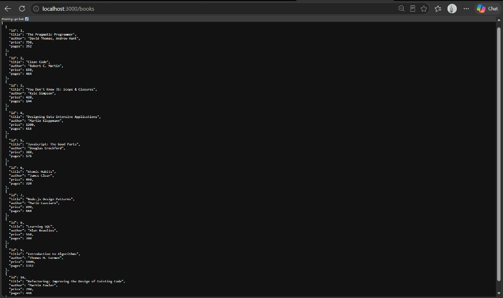

### 2. GET One Book (`GET /books/1`)
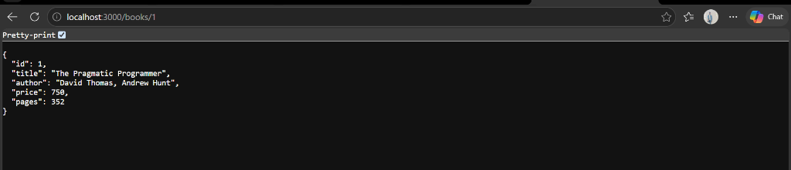

### 3. POST New Book (`POST /books`)
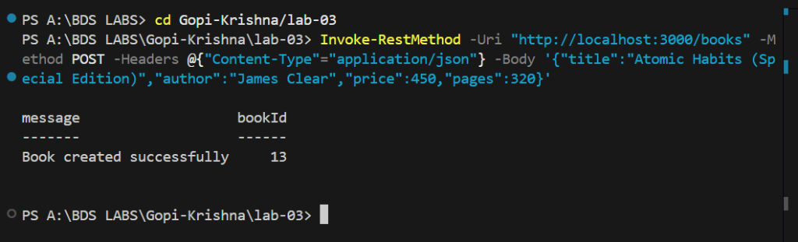

### 4. PUT Update Book (`PUT /books/:id`)
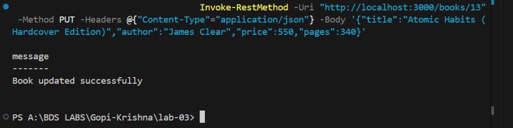

### 5. DELETE Book (`DELETE /books/:id`)
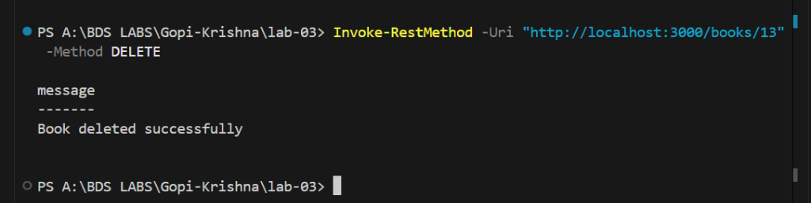

### 6. Search Functionality (`GET /books?search_q=Clean`)
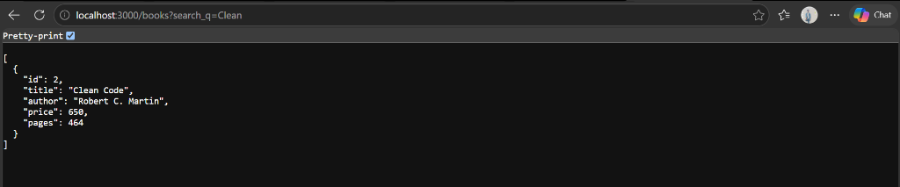

### 7. Sorting Functionality (`GET /books?order_by=price&order=DESC`)
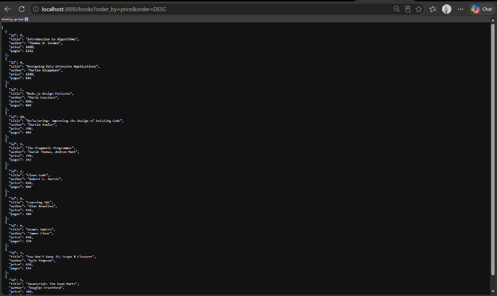

### 8. Pagination Using Limit and Offset (`GET /books?offset=2&limit=3`)
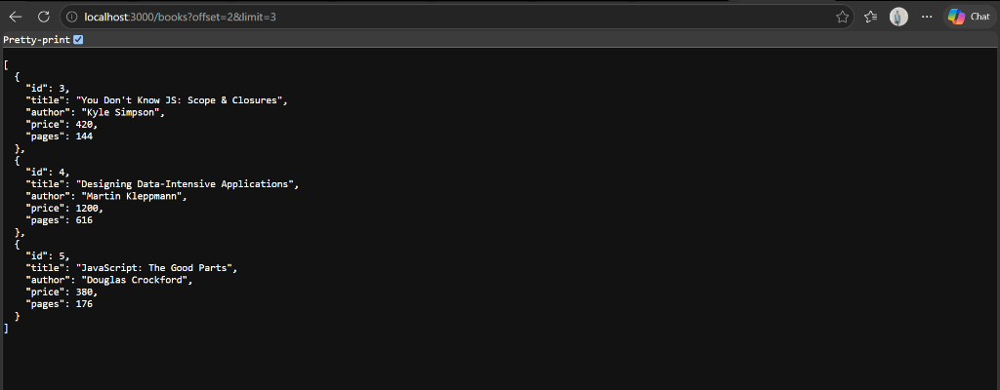

### 9. Price-Range Filtering (`GET /books?min_price=400&max_price=800`)
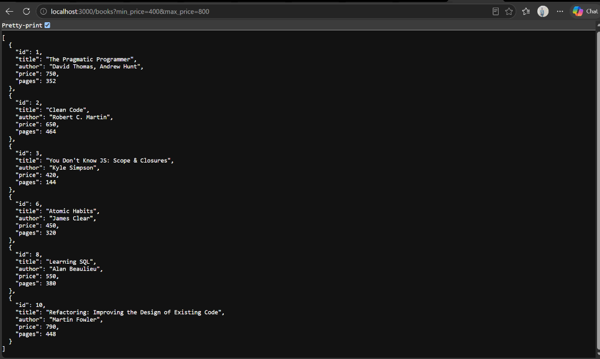

### 10. Validation Error for Missing Title (`POST /books`)
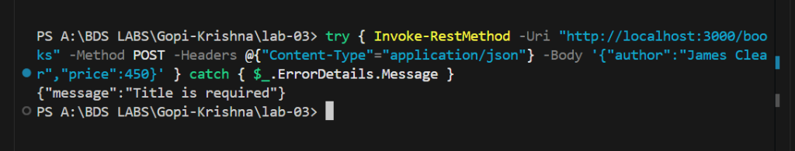

### 11. Validation Error for Invalid Price (`POST /books`)
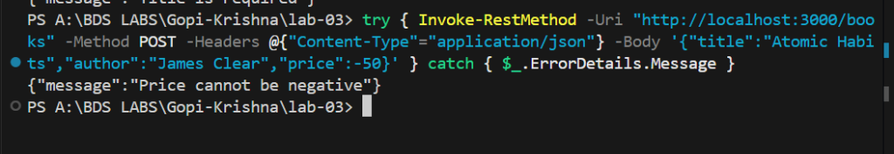

### 12. 404 Response (`GET /books/999`)
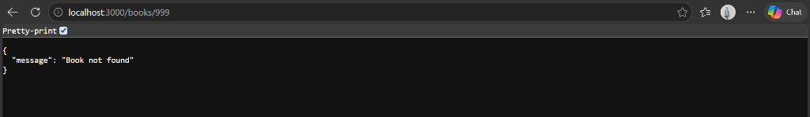

### 13. Postman / Automated Testing Evidence
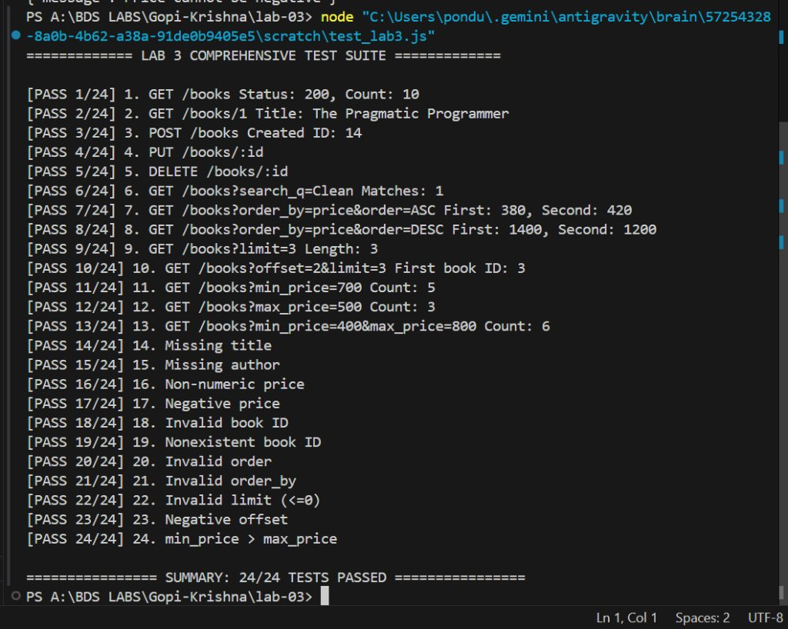

### 14. SQLite Database CLI Verification
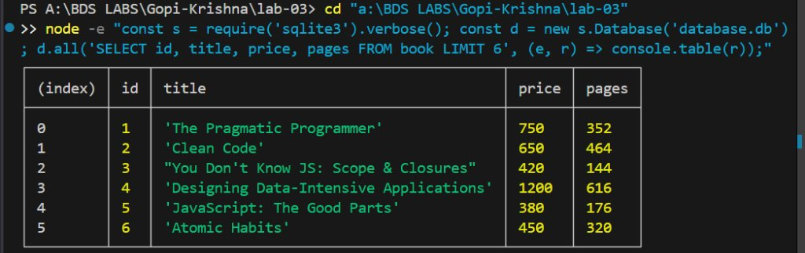

---

## 14. Problems Faced and Solutions

1. **SQL Injection Risks with Dynamic Sorting (`ORDER BY`):**
   - *Problem:* SQLite prepared statements (`?` placeholders) only bind data values, not SQL column names or ASC/DESC keywords. Directly interpolating user query strings into `ORDER BY` causes SQL injection vulnerabilities.
   - *Solution:* Implemented strict allowlists for `order_by` (`id`, `title`, `author`, `price`, `pages`) and `order` (`ASC`, `DESC`). Any value outside the allowlist is immediately rejected with HTTP `400 Bad Request`.

2. **Price Range Boundary Validation:**
   - *Problem:* Clients could send negative numbers or conflicting boundaries (`min_price=900&max_price=300`), producing misleading query results.
   - *Solution:* Parsed values into floating-point numbers, verified non-negativity, and checked that `min_price <= max_price`, returning explicit error messages on violation.

3. **Render Linux Deployment Compatibility (`sqlite3` GLIBC):**
   - *Problem:* Bleeding-edge `sqlite3` v6.x requires `GLIBC_2.38`, which is absent from standard Ubuntu 22.04 LTS containers.
   - *Solution:* Pinned `sqlite3` to production LTS version `5.1.7` across `package.json`, ensuring native prebuilt binary compatibility.

---

## 15. Conclusion

Lab 3 successfully enhanced the RESTful Book Management API with advanced query parameter filtering, partial text search, dynamic sorting, pagination, strict input validation, and comprehensive error handling. All 24 automated test cases passed, guaranteeing production-grade security and reliability.

